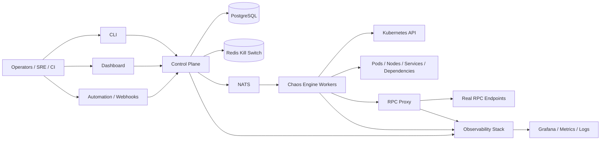
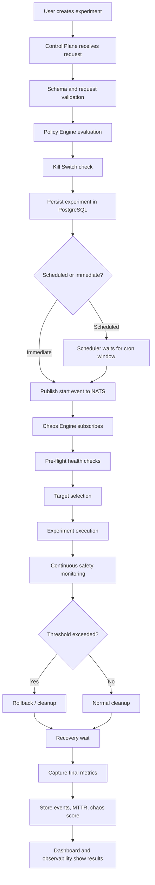
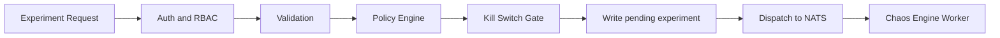
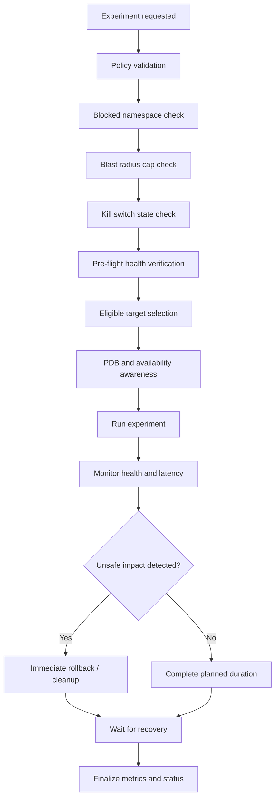
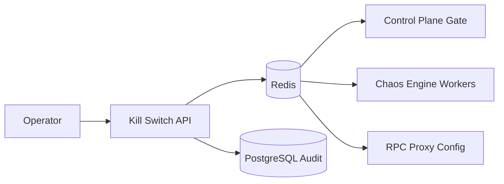
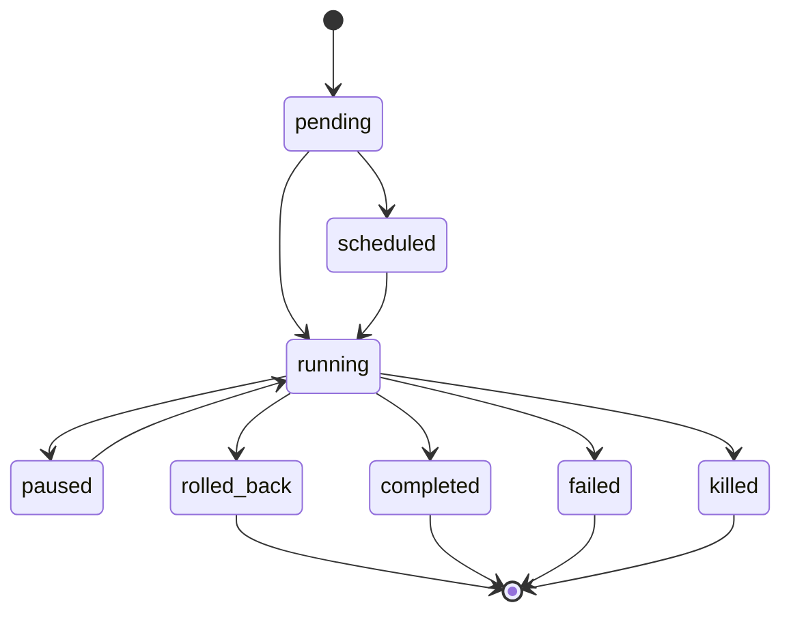
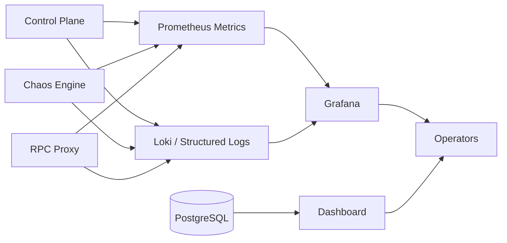
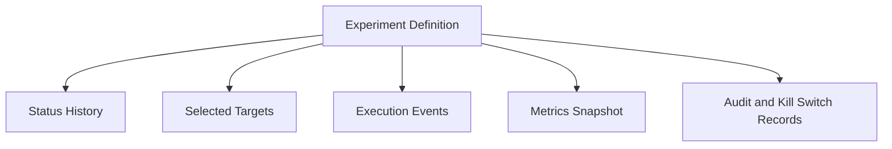
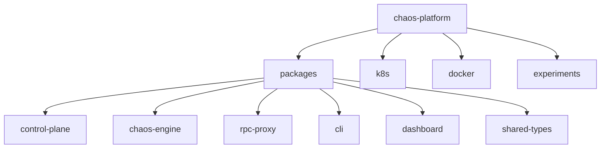

# Chaos Platform

Chaos Platform is a distributed chaos engineering system for Kubernetes and RPC-heavy infrastructure. It is designed so operators can define controlled failure experiments, route them through safety checks, execute them in workers, and measure whether the platform recovers inside acceptable limits.

This README explains how the platform works using Mermaid data-flow diagrams and architecture notes instead of implementation examples.

## What This Platform Does

- Accepts chaos experiment requests from operators, dashboards, CI systems, or automation.
- Validates each request through policy, kill-switch, health, and blast-radius controls.
- Publishes approved work to an execution layer instead of running chaos directly from the API.
- Executes different failure modes against Kubernetes workloads, nodes, dependencies, and RPC paths.
- Measures impact, recovery, and resilience outcomes through metrics and experiment events.

## Core Idea

The platform is split into a control plane and an execution plane.

- The control plane decides whether chaos should happen.
- The chaos engine decides how chaos is carried out.
- Redis is the fast safety path for stopping chaos.
- NATS is the decoupling path between decision-making and execution.
- PostgreSQL stores experiment state and history.
- Prometheus, Grafana, and Loki show what happened and how the system recovered.

## System Context

## How It Works

The system flow is intentionally staged. A request is not allowed to jump directly from the API into destructive action.

## Main Components

### 1. Control Plane

The control plane is the decision layer. It exposes the API, validates requests, enforces policy, stores state, manages schedules, and blocks new work when the kill switch is active.

Its responsibilities are:

- authenticate and authorize requests
- validate experiment structure
- evaluate policy rules
- reject blocked namespaces or invalid blast radius
- persist experiment records and event history
- schedule recurring experiments
- publish approved experiments to NATS

The control plane does not directly inject failures into workloads. That separation is deliberate so API restarts do not terminate running experiments.

### 2. Chaos Engine

The chaos engine is the execution layer. It consumes work from NATS and runs the appropriate runner for the requested experiment type.

Its responsibilities are:

- receive approved experiment start messages
- perform pre-flight health checks
- select eligible targets
- inject failure using the correct runner
- monitor error rate and latency during the run
- stop early when safety conditions fail
- clean up and wait for recovery
- compute metrics and resilience outcomes

### 3. RPC Proxy

The RPC proxy is a specialized failure-injection point for RPC traffic. It sits between clients and real RPC infrastructure and can inject latency, timeout, corruption, or dropped traffic without changing application code.

This is important for Solana-style systems where RPC behavior is a critical dependency and outages often happen in the request path rather than only in pods or nodes.

### 4. Data Stores and Messaging

- PostgreSQL is the source of truth for experiments, status, targets, events, and audit history.
- Redis is the fast control channel for kill-switch state and proxy configuration.
- NATS is the event bridge between orchestration and execution.

## Request and Decision Flow

This path matters because it creates clean separation between:

- who requested the change
- whether the change is allowed
- when the change should run
- which worker executes it

## Safety Flow

Safety is the most important design concern in this project. The platform assumes chaos must be stoppable even when other services are degraded.

### Safety Principles

- Global kill switch can stop new and active chaos across the platform.
- Namespace and experiment scoped kill switches reduce blast radius without halting all work.
- Workers check kill-switch state directly through Redis so safety does not depend on control-plane health.
- Blocked namespaces protect critical cluster infrastructure.
- Blast radius has a hard upper limit and should not be bypassed by experiment input.
- Health checks before and after execution prevent running chaos against already degraded systems.
- Runtime monitoring can trigger rollback if error-rate or latency thresholds are crossed.

## Kill Switch Data Flow

Why this matters:

- Redis provides a low-latency shared state for fast stop decisions.
- Workers do not need to wait for the API to respond before stopping work.
- Audit records still go to PostgreSQL so every engage and disengage event is reviewable later.

## Execution Lifecycle

### What Each State Means

- `pending`: accepted and stored, but not yet handed to a worker
- `scheduled`: waiting for a cron window
- `running`: active failure injection or active monitoring
- `paused`: execution intentionally suspended
- `rolled_back`: safety logic triggered cleanup before normal completion
- `completed`: duration ended and cleanup finished
- `failed`: execution could not proceed or ended with an unrecoverable error
- `killed`: manually stopped by operator action

## Observability Flow

The platform is not only meant to inject failure. It is meant to explain:

- what started
- what was targeted
- what impact was observed
- whether rollback was needed
- how long recovery took

## Data Model at a High Level

Each experiment should leave behind an operational record, not just a final status. That record is what lets teams compare resilience over time.

## Supported Failure Domains

| Domain | Intent | Typical Target |
|---|---|---|
| Pod disruption | Remove workload instances | Pods, deployments |
| Network impairment | Add latency, loss, or partitions | Pods, services, namespaces |
| RPC path chaos | Distort request and response behavior | Solana or other RPC consumers |
| Resource stress | Consume CPU, memory, or disk | Pods or nodes |
| Node disruption | Simulate infrastructure degradation | Kubernetes nodes |
| Dependency isolation | Break access to downstream systems | Databases, Redis, caches, APIs |

## Package Roles

| Package | Role in the platform |
|---|---|
| `packages/control-plane` | API, policy engine, scheduler, kill-switch endpoints, metrics routes |
| `packages/chaos-engine` | Worker runtime, runners, health checks, metrics collection, rollback |
| `packages/rpc-proxy` | RPC traffic failure injection layer |
| `packages/dashboard` | Operator-facing UI for status and resilience views |
| `packages/cli` | Command-line operator workflow |
| `packages/shared-types` | Shared contracts across services |

## Monorepo View

## Why This Architecture Works

### Decoupled execution

The API accepts and governs requests, but workers execute them asynchronously. This keeps the orchestration path clean and makes the system more resilient to partial failures.

### Fast safety path

The kill switch is not buried behind slow control logic. Redis gives workers a direct path to discover that chaos must stop.

### Measurable outcomes

The platform treats MTTR, error-rate change, latency change, and health recovery as core outputs, not side effects.

### Support for real production patterns

Many failures in modern systems happen in dependencies, traffic paths, or overloaded infrastructure, not just in pods. The architecture reflects that by supporting both Kubernetes-native and RPC-path experiments.

## How To Read This Platform

If you are new to the repo, read it in this order:

1. Start with the control plane because it defines the approval path.
2. Move to the chaos engine because it defines the execution path.
3. Review the kill-switch flow because it defines the safety model.
4. Review the RPC proxy if your workloads depend on RPC behavior.
5. Use the dashboard and metrics views to understand outcomes, not just activity.

## Summary

Chaos Platform is built around one operating principle: controlled failure must be easier to stop, observe, and explain than it is to start.

The architecture supports that principle by separating control from execution, putting safety on a fast shared path, and capturing operational evidence after every run.
